<div align="center">
  

  # IVAO México — Discord Authentication

  **Sistema de autenticación, vinculación y gestión de acceso al Discord oficial de IVAO México**

  Laravel 13 · IVAO SSO · Discord OAuth2 · Asignación automática de roles
</div>

## Descripción

**IVAO México Discord Authentication** permite a los miembros de IVAO vincular su identidad de IVAO con su cuenta de Discord y acceder al servidor oficial de la División México con los permisos correspondientes.

El flujo comienza con **Únete a Discord**: el usuario inicia sesión en IVAO (si todavía no tiene una sesión activa), autoriza su cuenta de Discord, y el sistema comprueba su perfil, vincula ambas cuentas y procesa los roles configurados. Al finalizar, muestra una pantalla de bienvenida con su nombre, VID, división y roles procesados, desde la cual puede abrir el servidor oficial.

El proyecto incluye un panel administrativo para gestionar las reglas de asignación y consultar a los miembros vinculados. La sincronización individual o programada permite mantener actualizados los roles administrados por el sistema.

## Flujo de autenticación

1. El usuario accede a **Únete a Discord** mediante `/discord/login`.
2. Si no tiene sesión IVAO, se autentica mediante **IVAO SSO** (`/ivao/login`).
3. Autoriza la vinculación mediante **Discord OAuth2**.
4. La aplicación valida su perfil IVAO, comprueba las condiciones configuradas y vincula su Discord con el VID.
5. El bot incorpora al usuario al servidor cuando corresponde y agrega los roles calculados.
6. Se presenta `/success`, con el resumen de la vinculación y un botón **Entrar al Discord oficial**.

La vinculación exige una cuenta IVAO elegible. Un VID se mantiene asociado a una sola cuenta Discord dentro de la política actual: al vincular otra cuenta Discord con el mismo VID, la cuenta anteriormente vinculada puede ser retirada del servidor.

## Reglas oficiales de IVAO México

El panel administra tres tipos de acceso:

| Rol de Discord | Condición |
| --- | --- |
| `MX-Member` | Usuario cuya división IVAO sea `MX`. |
| `MX-Staff` | Usuario de la división `MX` con una posición oficial cuyo identificador comienza por `MX-`. Incluye posiciones en periodo de prueba (`onTrial`). |
| `F-Member` | Usuario de una división distinta de `MX`. |

Las reglas se evalúan de manera independiente. Por lo tanto, un miembro del staff mexicano puede recibir **`MX-Member` y `MX-Staff` simultáneamente**. Un miembro de otra división recibe `F-Member` según las reglas actuales.

El sistema utiliza los roles gestionados por sus reglas; los permisos de acceso a categorías y canales deben configurarse también dentro de Discord. **La vinculación no impide por sí sola que alguien entre mediante una invitación normal**, pero los canales internos pueden restringirse a miembros verificados mediante sus roles.

### Roles del servidor

Los nombres e IDs actualmente configurados son:

| Rol | ID de Discord |
| --- | --- |
| `MX-Member` | `1555793312064082030` |
| `MX-Staff` | `1555794617994186822` |
| `F-Member` | `1555793918786928691` |

Estos identificadores pertenecen a la configuración actual de IVAO México y deben revisarse si el bot se instala en otro servidor. Las etiquetas mostradas en la pantalla de bienvenida se definen en `config/discord_join.php`.

## Funcionalidades

- Inicio de sesión con **IVAO SSO** y autorización con **Discord OAuth2**.
- Asociación entre VID de IVAO y cuenta de Discord.
- Validación del estado de la cuenta IVAO y de las condiciones de acceso.
- Asignación automática de roles `MX-Member`, `MX-Staff` y `F-Member`.
- Identificación de posiciones oficiales mexicanas, incluidas posiciones en prueba.
- Actualización del nickname en Discord según los datos disponibles del perfil IVAO.
- Página de bienvenida personalizada con VID, división y roles procesados.
- Panel `/admin` para reglas y miembros vinculados.
- Sincronización manual, individual y mediante tareas programadas.
- Comando `/sync` de Discord, sujeto a su configuración y registro.
- Interfaz de autenticación con identidad visual de IVAO México.

## Tecnologías y requisitos

- **PHP 8.4 o compatible con las dependencias fijadas en `composer.lock`**.
- **Composer 2**.
- **Laravel 13**.
- **MySQL o MariaDB** con una versión compatible con el proyecto.
- Extensiones de PHP requeridas por Laravel y sus dependencias.
- Un servidor web con **HTTPS** y document root dirigido a la carpeta `public/`.
- Aplicación IVAO SSO autorizada.
- Aplicación de Discord con OAuth2 y bot agregado al servidor.

Antes de desplegar en Plesk, verificar las versiones y extensiones disponibles con `php -v`, `composer check-platform-reqs` y la configuración PHP del dominio. La versión declarada en `composer.json` es Laravel 13 y el requisito de PHP es `^8.4`.

## Instalación

### 1. Obtener el proyecto

```bash
git clone git@github.com:bguzman78/ivao-mx-discord-auth.git
cd ivao-mx-discord-auth
git switch main
```

### 2. Instalar dependencias

Para desarrollo:

```bash
composer install
npm ci
```

Para producción:

```bash
composer install --no-dev --optimize-autoloader
```

Los archivos estáticos de la interfaz que necesita la aplicación deben estar presentes en `public/` al desplegar. Verificar cualquier compilación de assets necesaria para la versión publicada.

### 3. Preparar las variables de entorno

```bash
cp .env.example .env
php artisan key:generate
```

Configurar los valores reales de cada entorno. Como referencia, la instalación de IVAO México utiliza:

```dotenv
APP_NAME="IVAO Mexico Discord Auth"
APP_ENV=production
APP_DEBUG=false
APP_URL=https://DOMINIO-DE-PRODUCCION

LANGUAGE=es
DEFAULT_TITLE=IVAO_Mexico_Discord_Auth

DB_CONNECTION=mysql
DB_HOST=127.0.0.1
DB_PORT=3306
DB_DATABASE=BASE_DE_DATOS
DB_USERNAME=USUARIO_DB
DB_PASSWORD=CLAVE_DB

IVAO_CLIENT_ID=
IVAO_CLIENT_SECRET=
IVAO_SCOPES="profile configuration"

DISCORD_CLIENT_ID=
DISCORD_CLIENT_SECRET=
DISCORD_BOT_TOKEN=
DISCORD_GUILD_ID=
DISCORD_PUBLIC_KEY=
DISCORD_INVITE_URL=https://discord.gg/pjDGxgEKqf

ADMIN_VIDS=367964
MIN_HOURS=0
SYNC_TIME=04:00
SYNC_TIMEZONE=America/Mexico_City
```

**Importante:** los valores anteriores son una plantilla. Nunca copiar secretos de desarrollo a un repositorio ni publicar el `.env`. Ajustar la configuración de base de datos, dominio, IDs y permisos según el servidor real.

La **`APP_KEY` de producción debe conservarse** durante futuras actualizaciones: también se utiliza para descifrar las reglas guardadas. El archivo `storage/app/roles` y demás datos persistentes deben mantenerse entre despliegues.

### 4. Configurar las URLs de retorno

Registrar en **IVAO SSO**:

```text
https://DOMINIO-DE-PRODUCCION/ivao/callback
```

Registrar en **Discord Developer Portal → OAuth2**:

```text
https://DOMINIO-DE-PRODUCCION/discord/callback
```

La ruta `/discord/login` inicia la vinculación. Si no existe sesión IVAO, la aplicación continúa primero por el SSO de IVAO y retoma después la autorización de Discord.

En desarrollo local, usar exactamente el mismo host configurado en `APP_URL` y en los redirect URIs; por ejemplo, `http://127.0.0.1:8000`.

### 5. Preparar la base de datos y la caché

```bash
php artisan migrate --force
php artisan optimize
```

Para el entorno local, las migraciones se pueden ejecutar sin `--force`.

### 6. Configurar el bot en Discord

1. Agregar el bot de la aplicación al servidor oficial.
2. Conceder los permisos necesarios para **gestionar roles y nicknames**.
3. Colocar el rol del bot **por encima de los roles que debe asignar**, sin darle permisos administrativos innecesarios.
4. Configurar las categorías y canales para que `@everyone` no tenga acceso a áreas internas que requieran verificación.
5. Mantener visible el canal de instrucciones `#verifica-tu-cuenta` para usuarios sin roles.

**Nota:** por las restricciones de jerarquía de Discord, el bot no podrá modificar roles o nicknames de usuarios con una posición superior a la suya.

## Panel de administración

La administración está disponible en:

```text
/admin
```

El acceso se limita a los VIDs configurados en `ADMIN_VIDS`, separados por `:` cuando existan varios administradores.

Desde el panel es posible:

- Gestionar las reglas de asignación de roles.
- Consultar miembros vinculados y su información de IVAO y Discord.
- Revisar cambios esperados en roles y nickname.
- Iniciar sincronizaciones individuales o solicitar una sincronización general.
- Gestionar la desvinculación de cuentas según las opciones disponibles.

Las **reglas actuales de IVAO México están diseñadas para los tres roles definidos anteriormente** y no exigen configurar manualmente ratings, horas, posiciones de staff o titularidad de aerolíneas virtuales.

## Sincronización de miembros

Para actualizar los usuarios vinculados:

```bash
php artisan discord:sync
```

Para sincronizar únicamente un VID:

```bash
php artisan discord:sync 367964
```

La sincronización revisa los datos IVAO y actualiza los roles administrados por las reglas. Los roles externos a la gestión de esta aplicación no deben alterarse por ese proceso.

**Precaución:** antes de habilitar una sincronización general en el servidor oficial, validar con usuarios de prueba los casos de miembro MX, staff MX, miembro extranjero, perfiles con información oculta y cambio de estado de cuenta.

### Programación en Plesk

La configuración del proyecto utiliza por defecto:

```dotenv
SYNC_TIME=04:00
SYNC_TIMEZONE=America/Mexico_City
```

El servidor debe ejecutar el scheduler de Laravel. En **Plesk → Scheduled Tasks**, configurar una tarea que invoque:

```bash
php artisan schedule:run
```

Cada minuto, utilizando el binario PHP que corresponda a la versión del dominio y la ruta correcta de la aplicación. La programación no queda activa por el solo hecho de subir los archivos a producción.

### Comando `/sync` dentro de Discord

Para permitir que un miembro solicite la actualización de sus roles:

1. Configurar `DISCORD_PUBLIC_KEY` con la clave pública de la aplicación Discord.
2. Registrar en Discord el endpoint de interacciones `https://DOMINIO-DE-PRODUCCION/discord/interactions`.
3. Ejecutar una vez:

```bash
php artisan discord:register-commands
```

El endpoint requiere HTTPS público y una configuración válida de verificación de firmas.

## Interfaz de autenticación

La experiencia se presenta en español e incorpora los recursos visuales de IVAO México:

- Logotipo: `public/assets/imgs/mxivao_logo_white.webp`.
- Fondo inspirado en el inicio de sesión de IVAO: `public/assets/imgs/ivaoback.jpg`.
- Estilos compartidos: `public/css/ivao-auth-theme.css`.
- Pantalla de éxito: `resources/views/success.blade.php`.

La pantalla `/success` muestra información temporal de la vinculación. No debe considerarse una verificación independiente de que Discord haya aplicado todos los roles calculados si no se realiza una consulta de confirmación adicional.

## Desarrollo local

```bash
composer install
npm ci
cp .env.example .env
php artisan key:generate
php artisan migrate
php artisan serve
```

Ajustar las variables IVAO, Discord y base de datos antes de probar OAuth. Para validar el proyecto:

```bash
php artisan test
php artisan route:list
```

## Despliegue a producción

El código estable se mantiene en la rama **`main`** del repositorio de IVAO México. El despliegue en el Plesk oficial debe configurarse por separado; **publicar un commit en GitHub no despliega automáticamente la aplicación**.

Antes de habilitar el dominio público:

1. Verificar PHP, Composer y extensiones del servidor.
2. Configurar un directorio seguro y apuntar el document root a `public/`.
3. Crear el `.env` de producción fuera del repositorio.
4. Mantener los directorios de almacenamiento y los datos persistentes entre versiones.
5. Configurar HTTPS y los callbacks definitivos de IVAO y Discord.
6. Verificar que el bot conserva su jerarquía y permisos en el servidor.
7. Ejecutar migraciones y limpiar/reconstruir cachés cuando corresponda.
8. Probar una vinculación individual antes de habilitar sincronizaciones programadas.

No se debe asumir que un workflow FTP o CI/CD de otra división está habilitado para este repositorio sin haberlo configurado y validado previamente.

## Seguridad y consideraciones operativas

- No versionar `.env`, claves OAuth, tokens de bot, claves de sesión o contraseñas.
- Mantener `APP_DEBUG=false` en producción.
- Proteger `/admin` por autenticación IVAO y autorización por VID.
- Limitar los roles asignables y conservar las restricciones de jerarquía de Discord.
- Restringir canales internos mediante permisos de categorías y canales en Discord.
- Comprobar que las reglas se guardan correctamente antes de ejecutar sincronizaciones generales.
- Conservar copias de seguridad de la configuración y de los datos persistentes.

## Créditos y origen del proyecto

**Proyecto original:** [IVAO Brasil — ivao-discord-auth](https://github.com/ivao-brasil/ivao-discord-auth), desarrollado y publicado por la comunidad de **IVAO Brasil**. Gracias a sus autores y colaboradores por la base del sistema de autenticación y gestión de acceso a Discord.

**Adaptación para IVAO México:** **Chilam Guzmán** — adaptación funcional, integración de la identidad de la División México, lógica de membresía y staff mexicano, reglas de roles, flujo IVAO SSO → Discord OAuth2, experiencia de bienvenida y ajustes del panel administrativo.

Repositorio de la adaptación: [bguzman78/ivao-mx-discord-auth](https://github.com/bguzman78/ivao-mx-discord-auth).

Se mantiene el reconocimiento al proyecto de origen y a sus contribuyentes. El proyecto declara licencia **MIT** en `composer.json`; deben respetarse también las condiciones y avisos de licencia aplicables al código original.
